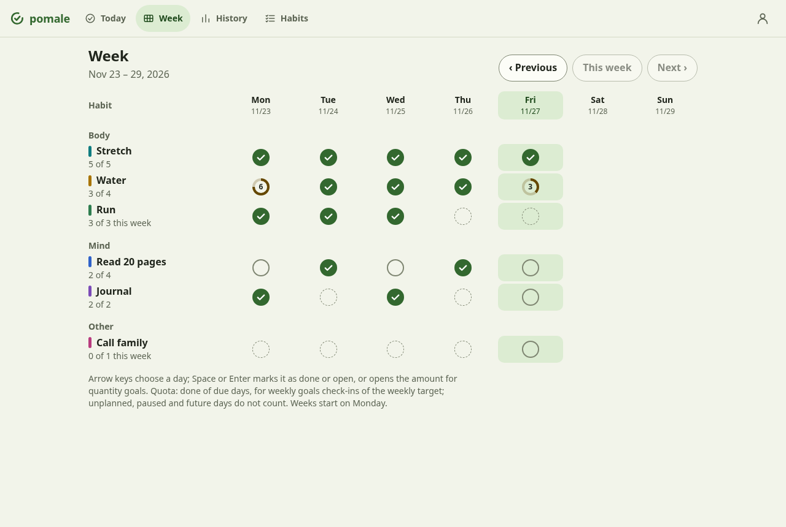
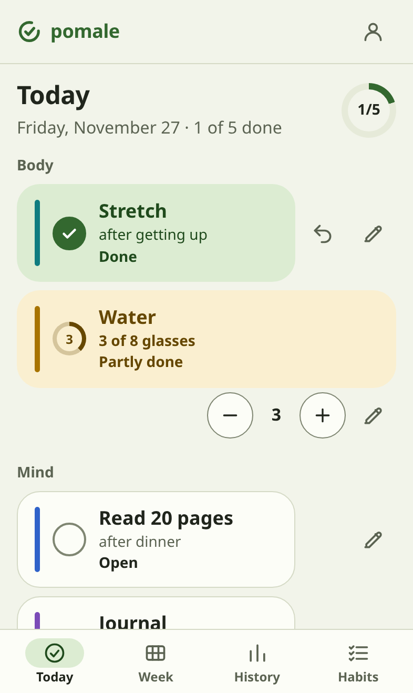

# pomale

> **pomale** (po-MAH-leh): Austrian for "take it slow".

Habits grow at their own pace. pomale is a small, self-hosted habit tracker for your phone and your laptop. Check off a habit in a second on the iPhone, review and correct the week on a big screen. No points, no streaks that reset to zero, no notes you have to write.

> Status: **1.0 – stable.** The API you reach with a key, the settings and the export formats stay compatible until 2.0; see the [stability promise](docs/api.md#stability).

**Try it:** [demo.pomale.percuro.at](https://demo.pomale.percuro.at) opens with one click, with sample data. Everything is reset at the full hour.

<p>
  
  
</p>

More pictures, also in dark mode: [docs/screenshots.md](docs/screenshots.md).

## Features

- **Today view:** one tap marks a habit done, "undo" sits right next to it, and the row never jumps away.
- **Week view:** habits × days, fully keyboard-operable, with an honest quota like "4 of 5 due days" instead of a streak.
- **Goals:** on chosen weekdays, "3× a week, any day", or an amount per day ("8 glasses") with − and +. Plan changes take effect from a date, so past weeks keep their numbers. Not planned, open and done are different states; extra check-ins never hurt the quota.
- **Night owls welcome:** your day can end at 1, 2 … 6 a.m. instead of midnight, so a habit done at 00:30 still counts for the day you were living.
- **Pauses** for holidays or illness, also entered afterwards: paused days are not due.
- **History:** quota per period, a 12-week trend and a month calendar – no streaks to lose.
- **Groups, colours and drag-to-sort** (with a keyboard alternative), and an optional note per habit and day.
- **Reminders:** up to three times per habit, sent only if the habit is still open – on iPhone (home-screen app, iOS 16.4+), Android and desktop browsers, with a "Done" button where the system shows one. End-to-end encrypted, no extra service.
- **Works offline:** installable web app (iPhone home screen, Android, desktop). Changes made offline are queued, marked, and sent when the app is back online. A conflicting change from another device is shown to you, never silently overwritten.
- **iOS shortcut widget:** a revocable key for exactly one habit lets an iOS Shortcut check it off from the home screen, and Siri can tell you what is still open today.
- **API keys** for scripts and home automation such as Home Assistant: read and/or check off, optionally for some habits only – never more. The API is described in `/api/openapi.json`.
- **For a family, a flat share or a club:** admins invite people with a one-time link; everyone has their own habits, time zone and language, and nobody sees anyone else's data.
- **Single sign-on (optional):** log in through your own OpenID Connect provider such as Authelia, Authentik or Pocket ID, with or without pomale passwords.
- **Audit log** for admins: logins, roles, invitations and keys.
- **English and German**, following the browser or the account's choice.
- **Your data stays yours:** CSV for spreadsheets, a complete JSON export that imports into an empty account on any pomale, built-in daily backups, plain SQL dumps for your own backup tool, health endpoint.
- **Small footprint:** one container, one SQLite file, no external services (reminders use the browsers' own push services).

## Quick start

```bash
mkdir habits && cd habits
curl -fsSLO https://raw.githubusercontent.com/percuro/pomale/main/compose.yaml
echo "PUBLIC_URL=https://habits.example.org" > .env
docker compose up -d && docker compose logs app   # shows the one-time setup token
```

Then point a TLS reverse proxy at `127.0.0.1:8000` and open `https://habits.example.org/setup`. Details: [docs/self-hosting.md](docs/self-hosting.md).

## Documentation

- [Self-hosting](docs/self-hosting.md): install, reverse proxy (Caddy, Traefik, Nginx Proxy Manager), users and invitations, updates, backup and restore
- [Configuration](docs/configuration.md): all environment variables
- [Single sign-on](docs/oidc.md): OpenID Connect with Authelia, Authentik, Pocket ID and others
- [Reminders](docs/reminders.md): Web Push on iPhone, Android and desktop, privacy, troubleshooting
- [iPhone](docs/iphone.md): home-screen app, offline use, reminders, shortcut widget, Siri
- [API](docs/api.md): API keys, examples with curl and Home Assistant, the stability promise, error codes, JSON export and import
- [Development](docs/development.md): running and testing from source
- [Design notes](docs/design.md): why it works the way it does
- [Design language](docs/design-language.md): the look, and the rules behind it
- [Accessibility](docs/accessibility.md): keyboard, screen readers, text size, and how it is checked

## Roadmap

- ~~**0.4** multiple accounts with invitations, per-account time zone, English and German interface~~ ✓
- ~~**0.5** single sign-on (OpenID Connect), audit log~~ ✓
- ~~**0.6** weekly targets ("3× a week"), quantities, pauses, history view~~ ✓
- ~~**0.7** reminders via Web Push~~ ✓
- ~~**0.8** new look, design language shared with fahrma~~ ✓
- ~~**0.9** day end after midnight, per account~~ ✓
- ~~**0.10** personal API keys, JSON export/import, built-in daily backups, "what is still open today", `/api/openapi.json`~~ ✓
- ~~**0.11** beta hardening: accessibility, performance, upgrade tests~~ ✓
- ~~**1.0** stable API and configuration, signed images, a public demo~~ ✓
- **Later:** outgoing webhooks on check-ins

## Sibling project

[fahrma](https://github.com/percuro/fahrma) is a cost tracker for shared cars by the same author: hosted the same way, under the same license, and built with the same [design language](docs/design-language.md) in a different character.

## License

Source-available under the [PolyForm Noncommercial License 1.0.0](LICENSE) with an [addendum](LICENSE-ADDENDUM.md):

- **Free** for personal use and for non-profit organisations, including clubs and associations, also when they host it for their members.
- **Commercial use requires a license**: for example offering it as a paid hosted service or using it inside a company. See [COMMERCIAL.md](COMMERCIAL.md).

Contributions are welcome under the [Contributor License Agreement](CLA.md); see [CONTRIBUTING.md](CONTRIBUTING.md).
