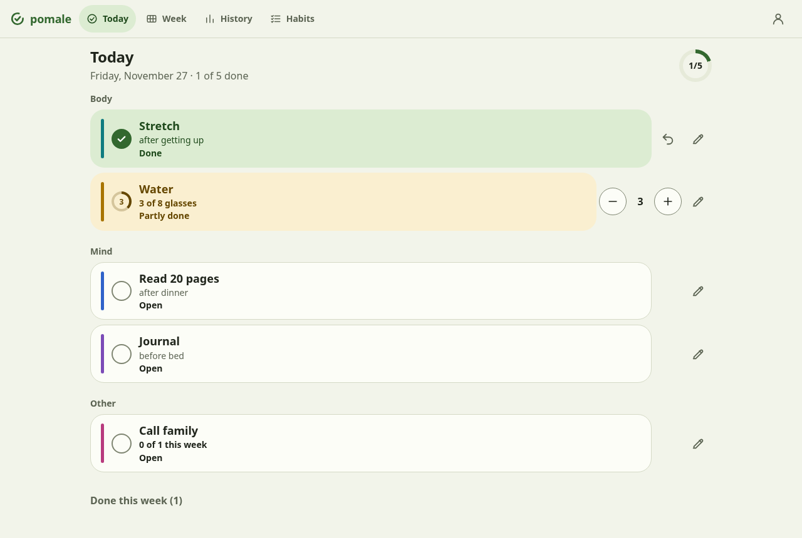
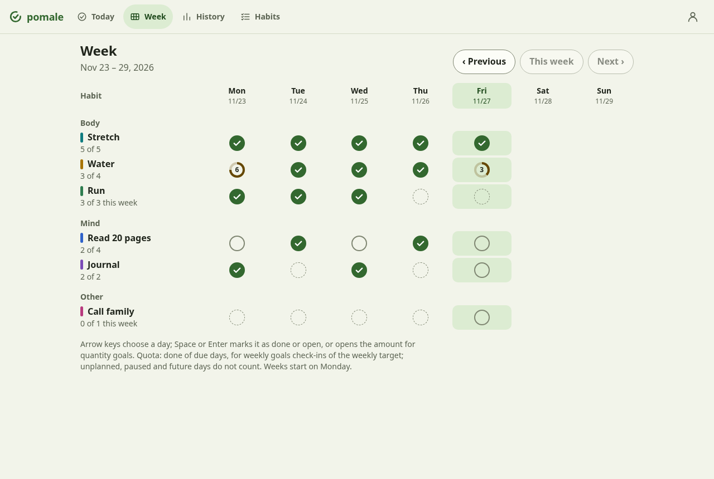
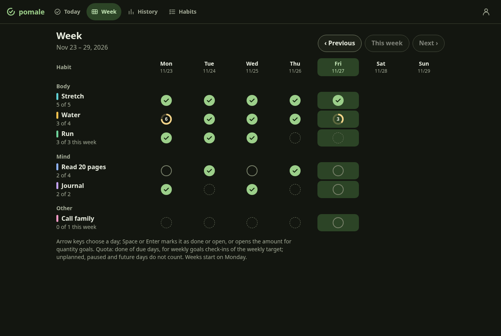
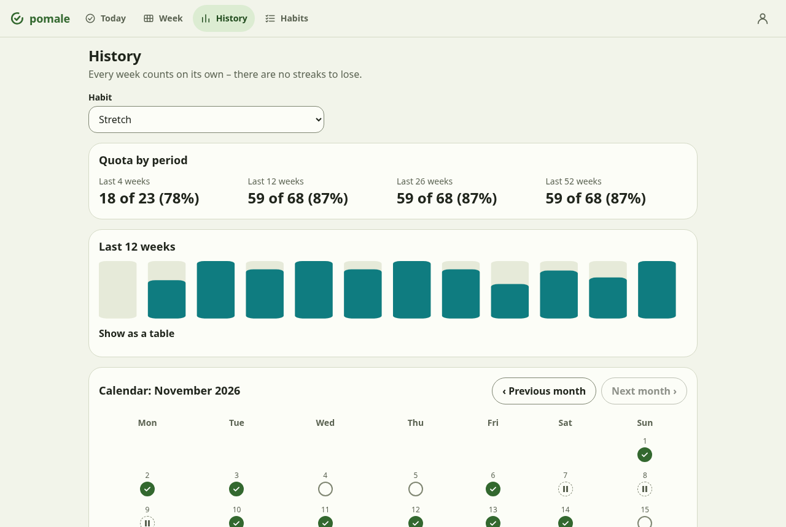
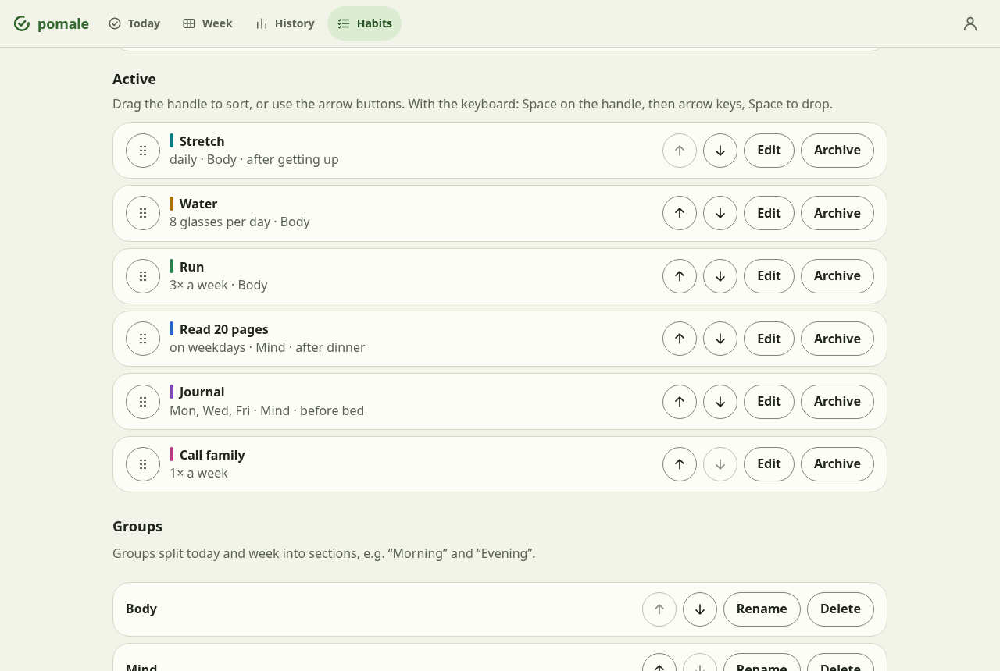
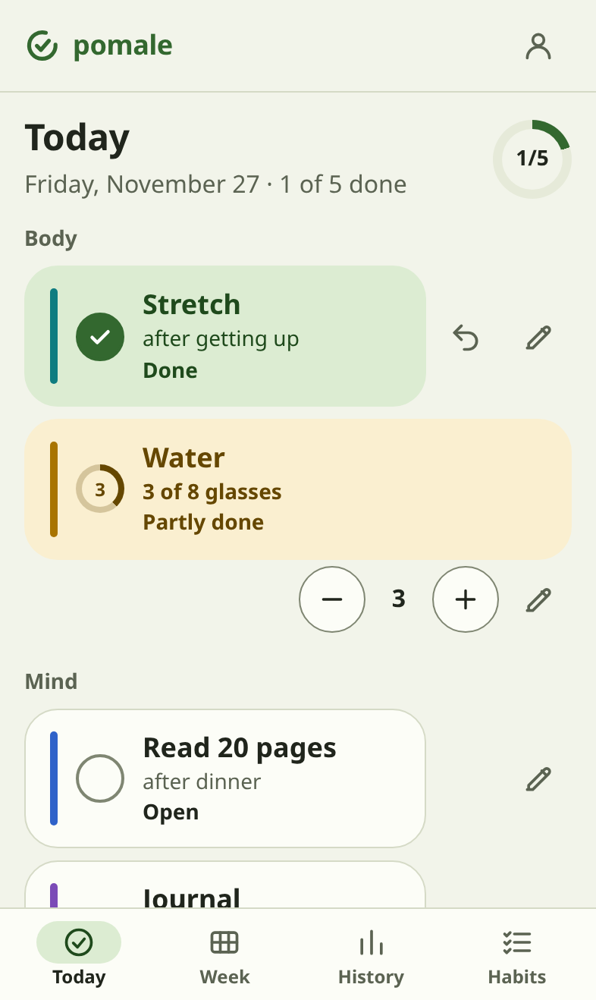
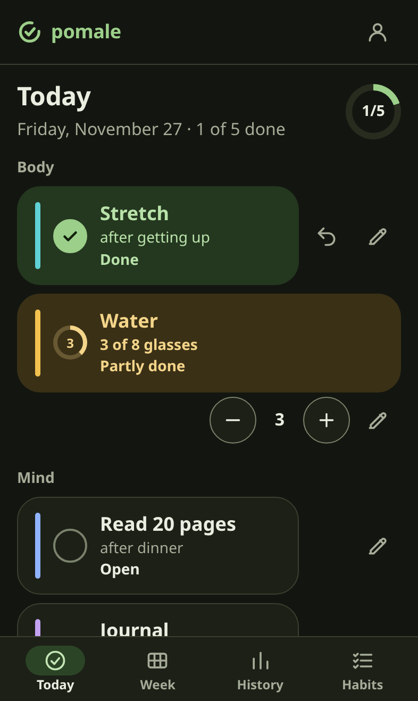
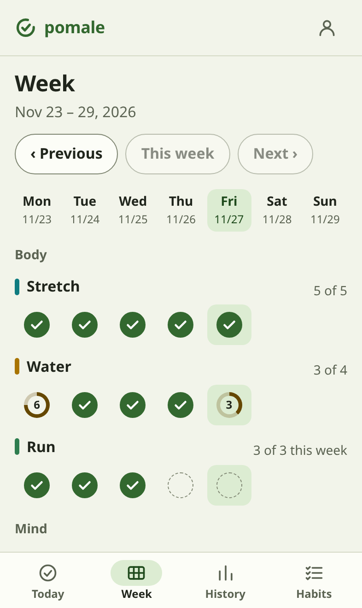

# Screenshots

All pictures show the sample data of the [demo](https://demo.pomale.percuro.at) (`DEMO_MODE`). They are taken with `e2e/screenshots/` from a demo instance (see the comment in `screenshots.config.ts`), so they can be renewed after every change of the look.

## Desktop

## iPhone

  
  
  

